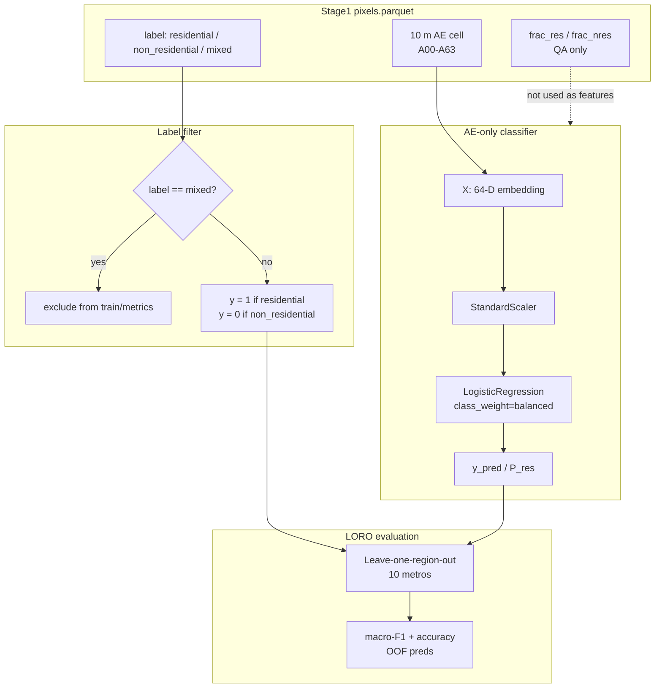

# Week 3 — Pixel AE residential classifier (Stage 2)

**Status:** design locked 2026-09-24  
**Notebook:** [`notebooks/week3/02_pixel_ae_loro_classifier.ipynb`](../../notebooks/week3/02_pixel_ae_loro_classifier.ipynb)  
**Data:** [`datasets/week3_pixel_gt/pixels.parquet`](../../datasets/week3_pixel_gt/pixels.parquet)  
**Outputs:** `outputs/week3_pixel_ae/`  
**Label definition:** `resi_def_v1_pixel_overlap_v1` (Stage 1 hard labels)

## Motivation

Overture building-use tags are sparse globally. Predictions must live on the **10 m AlphaEarth cell**, not the polygon. Stage 1 materializes pure RES / NRES / mixed cells under labeled footprints; Stage 2 trains a supervised binary head on **pure cells only**.

## Label rule

| Stage 1 `label` | `y` | Train? |
|---|---|---|
| `residential` | 1 | yes |
| `non_residential` | 0 | yes |
| `mixed` | — | **no** (report rate only) |

`frac_res` / `frac_nres` are **coverage QA** (fraction of the pixel covered by RES / NRES polygons). They are **not** model features and not the training target.

On the **pure** subset, Kyle’s area-weighted \(f_{res}\) collapses to 0 or 1 and yields the **same class** as this hard label (see [`docs/residential_definition_v1.md`](../residential_definition_v1.md) Track B). Mixed cells are ignored at this stage.

## Model

AlphaEarth-only, mirroring notebooks 02 / 05 / week2 centroid baseline:

- **X:** `A00`–`A63` (64-D annual AE 2024)
- **Pipeline:** `StandardScaler` → `LogisticRegression(class_weight="balanced", max_iter=2000)`
- **Protocol:** leave-one-region-out (LORO) over 10 US metros
- **Metric:** macro-F1 (primary), accuracy
- **Unit:** one prediction per 10 m cell (no bbox CNN)

## Pipeline diagram

## Artifacts

| Path | Contents |
|---|---|
| `outputs/week3_pixel_ae/loro_metrics.csv` | Per-region n, accuracy, macro-F1 |
| `outputs/week3_pixel_ae/oof_predictions.parquet` | `pixel_id`, `region`, `y`, `y_pred`, `p_res`, fracs |
| `outputs/week3_pixel_ae/summary.json` | Mean±std LORO, mixed excluded, hyperparams |
| `outputs/week3_pixel_ae/figures/` | Per-region F1 bar, OOF confusion |

### Headline (last run)

Mean LORO macro-F1 **0.563 ± 0.082** · OOF macro-F1 **0.558** · accuracy **0.680** · mixed excluded **137**.

| Unit / model | Mean LORO macro-F1 |
|---|---:|
| Building centroid LR (week2) | 0.696 |
| Building bbox CNN (week2) | 0.746 |
| Pixel AE LR (week3) | **0.563** |

Comparison plots: `outputs/week3_pixel_ae/figures/polygon_vs_pixel_*.png`  
CSV: `outputs/week3_pixel_ae/polygon_vs_pixel_loro_comparison.csv`

Claim language: pixel-level unit — not directly comparable to building-level without noting the unit change.

## Out of scope (later)

- Soft \(f_{res}\) / coverage regression
- Training on mixed
- Patch CNN / dense AOI inference
- GHSL pixel_eval head-to-head
- DoU stratification
